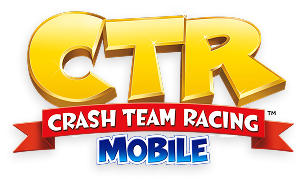
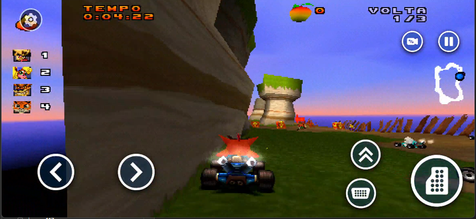
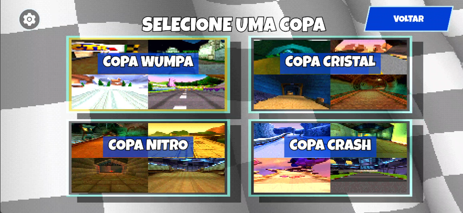
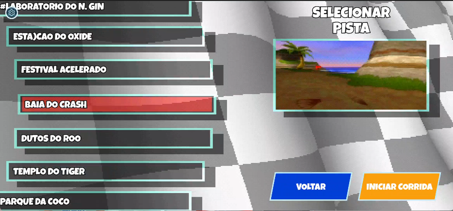
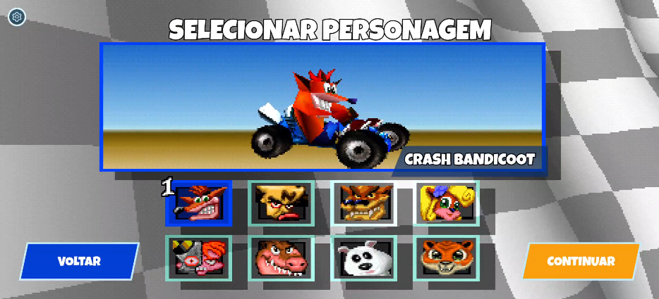
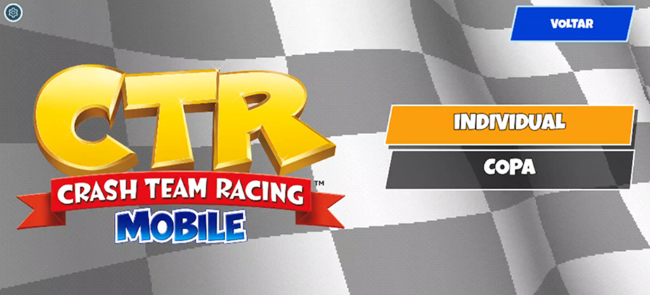
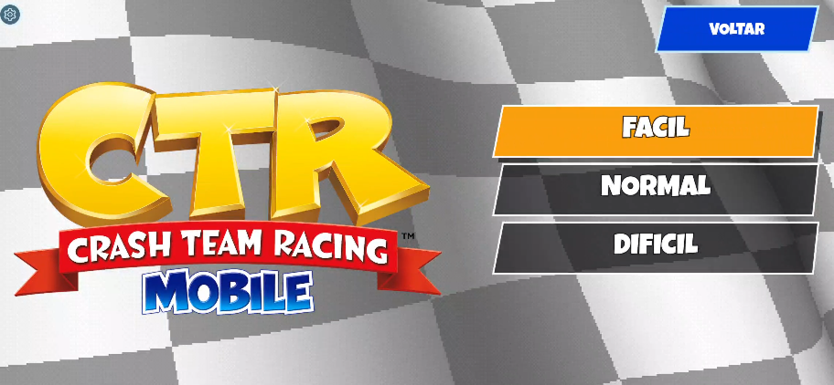
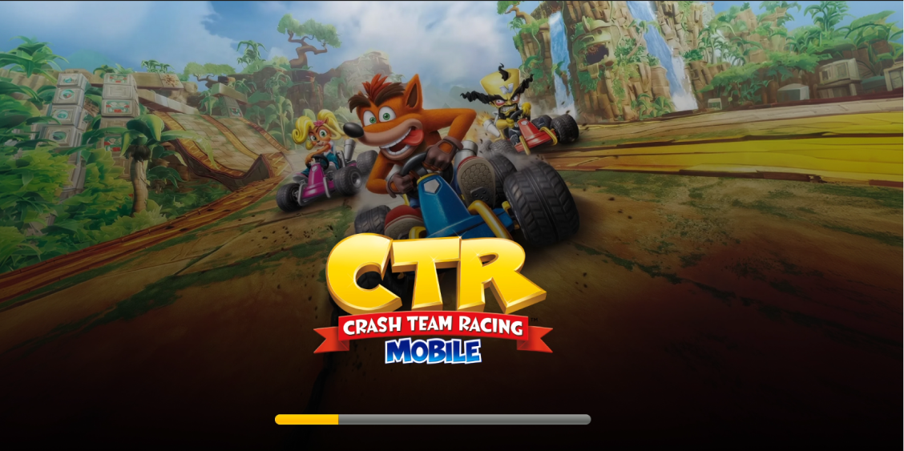

<p align="center">
  
</p>

<h1 align="center">CTR Mobile</h1>

<p align="center">
  Crash Team Racing no Android, com controles de toque, suporte a gamepad e tela complementar.
</p>

<p align="center">
  <a href="#capturas-de-tela">Capturas</a> ·
  <a href="#compilar">Compilar</a> ·
  <a href="#carregar-o-jogo">Carregar o jogo</a> ·
  <a href="#documentacao-e-licencas">Documentação</a>
</p>

## Visão geral

CTR Mobile é um port Android de Crash Team Racing baseado no projeto de descompilação
[CTR-ModSDK](https://github.com/CTR-tools/CTR-ModSDK). O jogo é compilado a partir de
código nativo em C/C++ e usa SDL3.

O app aceita imagens NTSC-U nos formatos BIN e CHD. A imagem do jogo deve ser
fornecida por você: ela não está incluída neste repositório nem no APK.

## Capturas de tela

| Menu principal | Corrida com controles de toque |
|:---:|:---:|
|  |  |
| **Seleção de copa** | **Seleção de pista** |
|  |  |
| **Seleção de personagem** | **Modos de corrida** |
|  |  |
| **Dificuldade** | **Carregamento** |
|  |  |

## Compilar

### Requisitos

- Android Studio e Android SDK.
- NDK `27.2.12479018` e CMake `3.22.1`.
- Dispositivo ou emulador com OpenGL ES 3.0.

### Gerar o APK de debug

No Windows, pelo PowerShell:

```powershell
cd android
.\gradlew.bat :app:assembleDebug
```

No macOS ou Linux:

```sh
cd android
./gradlew :app:assembleDebug
```

O APK será gerado em `android/app/build/outputs/apk/debug/app-debug.apk`.
O projeto configura as ABIs `armeabi-v7a`, `arm64-v8a` e `x86`.

## Carregar o jogo

No primeiro início, selecione seu arquivo NTSC-U `ctr-u.bin` ou `ctr-u.chd` no
launcher. O app valida e copia a imagem para o armazenamento privado. A cópia
original não é alterada. Veja o [guia Android](README_ANDROID.md) para instalar,
configurar controles e consultar o diagnóstico.

## Estrutura do projeto

| Pasta | Conteúdo |
|---|---|
| `android/` | App Android, interface, recursos e build Gradle |
| `game/`, `include/`, `platform/` | Jogo e integração nativa |
| `externals/` | SDL3, ENet e libchdr vendorizados |
| `tests/` | Verificações host e fluxos Android |
| `docs/` | Arquitetura, fluxos e guias de manutenção |
| `tools/` | Utilitários de assets |

<h2 id="documentacao">Documentação e licenças</h2>

- [Guia Android: build, instalação, importação e controles](README_ANDROID.md)
- [Recursos e configurações do CTR-DS](README_CTRDS.md)
- [Índice da documentação técnica](docs/README.md)
- Licenças das dependências: [SDL3](externals/SDL/LICENSE.txt),
  [ENet](externals/enet/LICENSE) e [libchdr](externals/libchdr/LICENSE.txt).
