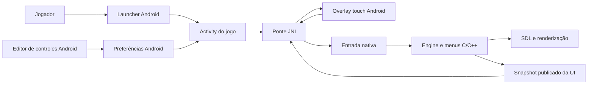

# Arquitetura — CTR Mobile

## Visão geral

O produto é um app Android com interface Java/Kotlin do sistema (atualmente Java), engine de jogo em C/C++ e SDL3. O Gradle em `android/` configura o app e invoca o CMake raiz para compilar a biblioteca nativa. O CMake raiz rejeita builds fora do Android.

## Camadas e responsabilidades

| Camada | Local principal | Responsabilidade |
|---|---|---|
| App Android | `android/app/src/main/` | Activities, recursos, manifest, ciclo de vida, importação e preferências. |
| Launcher | `CTRNativeLauncherActivity` | Estado do jogo importado, configurações iniciais e entrada no jogo. |
| Host do jogo | `CTRNativeActivity` | Ciclo de vida SDL, loading, configurações durante a partida e integração com o estado nativo. |
| UI de toque | `CTRTouchOverlay` | Renderização das ações Android, hit-tests e encaminhamento dos toques. |
| Editor/configuração | Activities e recursos Android | Preferências, layout de controles e bindings do gamepad. |
| Ponte de plataforma | `platform/`, `include/`, JNI Android | Entrada, callbacks e transferência explícita de estado entre Java e C. |
| Engine | `game/`, `main.c` | Regras, menus, progressão, cenas e renderização do jogo. |
| Dependências externas | `externals/` | SDL3 e outras dependências vendorizadas. |

## Fluxo de dados da UI

O estado do jogo e a progressão pertencem à engine. No Android, produtores nativos montam e publicam snapshots consistentes para a camada Java; JNI copia o snapshot publicado. A UI Android usa esse pacote para desenhar e apresentar hitboxes, e encaminha as ações pela entrada nativa. Ela não deve percorrer estruturas vivas da engine nem reconstruir suas regras de navegação.

Ao introduzir ou alterar um produtor de UI, mantenha sincronizados produtor, snapshot, JNI, modelo Android, desenho e hit-test. Gerações e estados de prontidão ajudam a impedir que ações antigas atinjam uma tela nova. Consulte [arquitetura da UI Android](android-ui-architecture.md) para estados e detalhes de sincronização.

## Contratos importantes

- O alvo de produto e de build deste checkout é Android; use `android/` com Gradle. `CTR_NATIVE` identifica caminhos do port e não significa que o CMake raiz aceite desktop. Use `__ANDROID__` para comportamento exclusivo de Android.
- A engine mantém as regras e a navegação original; Java mantém ciclo de vida, UI de sistema, preferências e apresentação touch.
- A imagem do jogo é fornecida pelo usuário, importada para armazenamento privado e não é parte do repositório.
- SDL e Canvas Android são superfícies de apresentação distintas. Build aprovado não prova composição correta, toque ou comportamento em dispositivo.
- `externals/` é código vendorizado; evite alterações locais sem necessidade e escopo explícitos.

## Build e verificações

- Build Android: `cd android; .\gradlew.bat :app:assembleDebug` no PowerShell.
- Testes host disponíveis são específicos por área; escolha o script pertinente em `tests/`.
- Mudanças visuais, de input, ciclo de vida ou compatibilidade precisam de verificação no aparelho/emulador correspondente para alegar aceite de runtime.

Para padrões de tela, veja o [guia de alteração de UI](android-ui-change-guide.md); para fluxos do jogo, o [mapa de fluxos](game-flow-map.md); para as regras comuns de mudança, o [contrato de alterações](CHANGE_CONTRACT.md).
