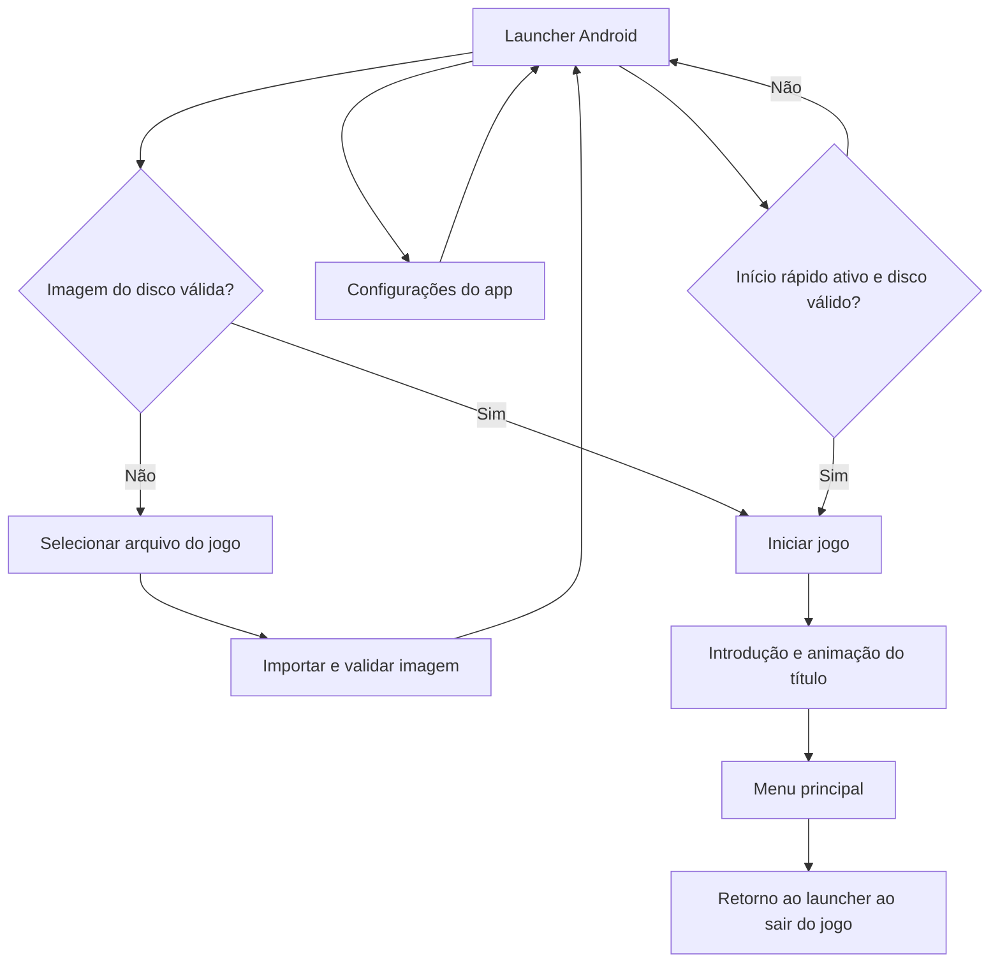
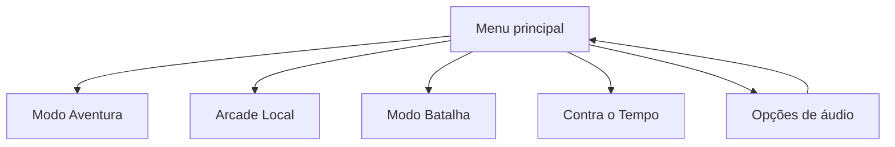
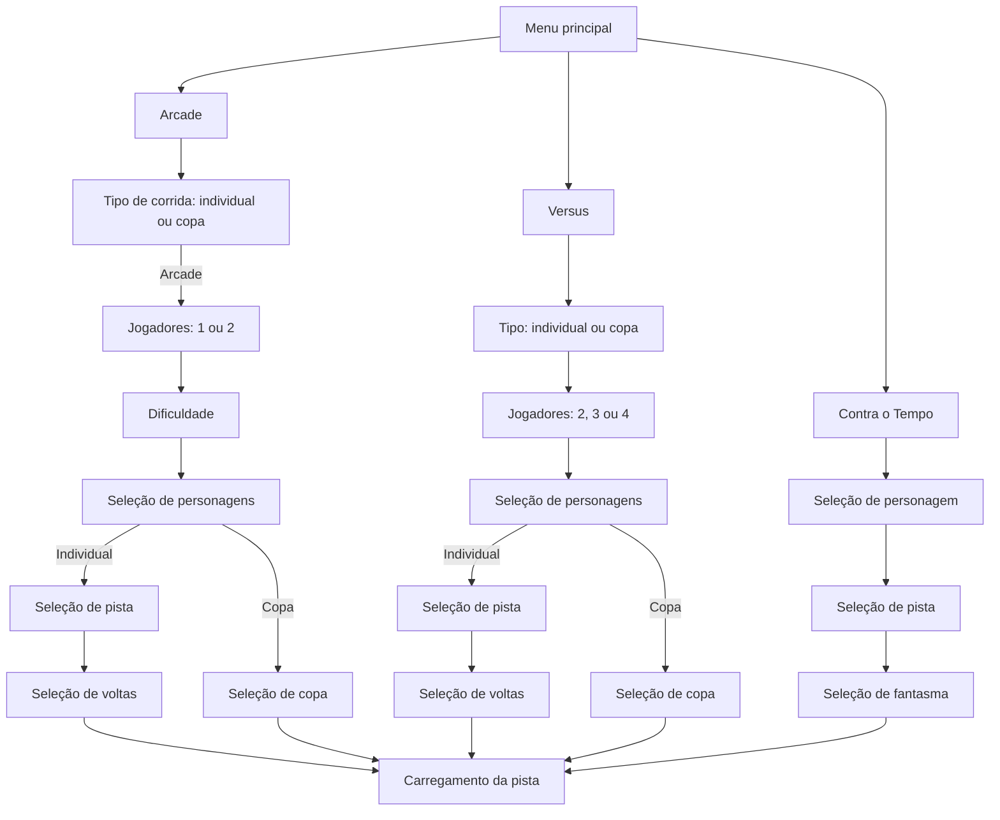
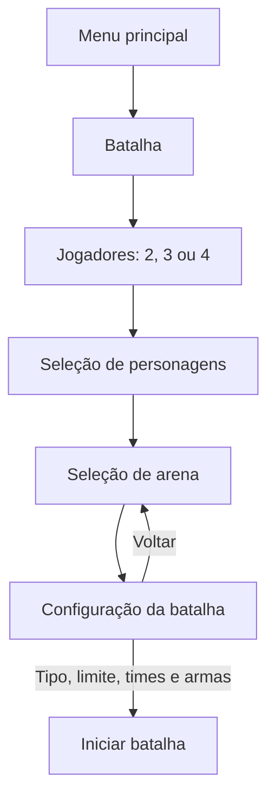
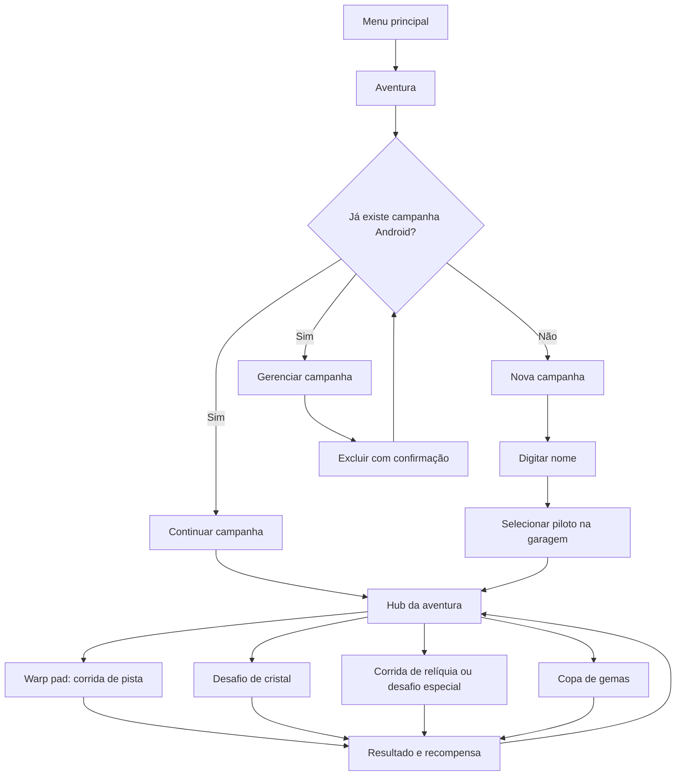
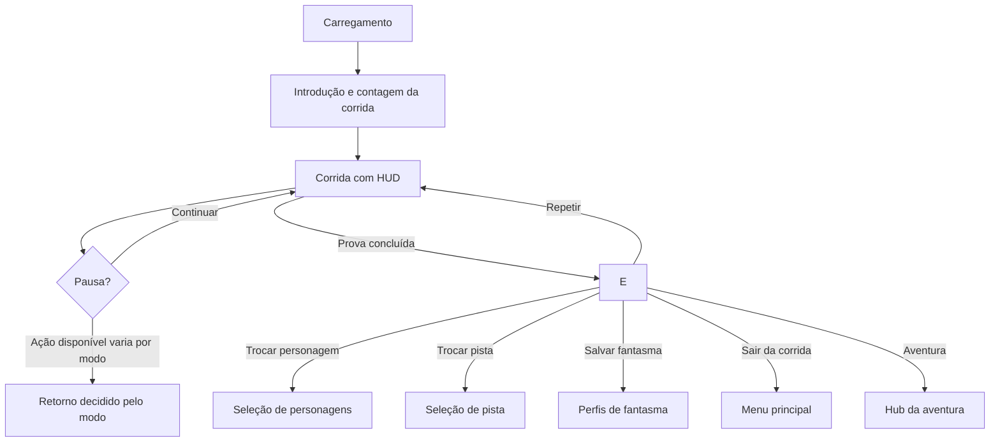

# Mapa dos fluxos do jogo

Este mapa descreve a navegação identificada no código do jogo e no launcher Android. Ele serve como base para reconstruir as telas e ligar o toque às ações originais. Os nomes entre parênteses são os símbolos ou estruturas usados no código.

## 1. Entrada no jogo

O launcher é uma tela Android separada. Depois dele, o jogo original assume a navegação. Na primeira abertura, a animação do título bloqueia a seleção até o menu ficar pronto; toque ou botão pode pular a introdução.

## 2. Menu principal

No Android, o menu principal expõe **Modo Aventura**, **Arcade Local**, **Modo Batalha**, **Contra o Tempo** e **Opções**. Cada modo segue sua rota nativa com os submenus responsivos do overlay.

## 3. Fluxos de corrida

Na seleção de personagens, cada jogador confirma seu retrato; a tela avança quando todos confirmam. O botão de voltar retorna ao menu principal. Na seleção de pista, a confirmação abre a escolha de voltas nos modos que a usam; Contra o Tempo segue para fantasma. Pistas e personagens bloqueados são filtrados pelo progresso salvo.

## 4. Batalha

A configuração da batalha é uma tela própria, não uma lista simples: tipo de batalha, duração/vidas/pontos, times, armas disponíveis e início. Depois da batalha, o resultado permite continuar, repetir ou voltar à configuração, conforme as opções apresentadas pelo jogo.

## 5. Aventura

No Android, a campanha usa um arquivo único: nome, seleção do piloto e então hub; campanhas existentes podem ser continuadas ou excluídas. Os quatro slots legados não fazem parte desse fluxo e permanecem intactos. Nas demais plataformas, o seletor de perfis original continua sendo usado. O hub é navegado no cenário: o jogador dirige até warp pads, portas e personagens. O tipo de desafio depende dos desbloqueios; algumas corridas retornam ao hub, e desafios de história podem passar por cenas e pódios.

## 6. Recordes e Scrapbook

- **Recordes:** tela própria com navegação entre categorias/resultados e prévia de pista; voltar retorna ao menu principal.
- **Scrapbook:** reprodução de vídeo/filme desbloqueado; pode ser interrompido e retorna ao fluxo do título.
- **Seleção de fantasma:** tela de perfil para carregar ou salvar fantasma, usada pelo Contra o Tempo e pela opção de salvar recorde após uma corrida.
- **Perfis:** telas compartilhadas para novo jogo, carregar, salvar e excluir progresso. Confirmações/erros podem abrir caixas adicionais.

## 7. Corrida, pausa e encerramento

As opções exatas de pausa e da tela de fim mudam por modo. O estado de pausa é comum, mas o destino de sair/reiniciar depende da prova ativa; copas, batalhas, aventura e Contra o Tempo também exibem dados e ações adicionais. Pausa e resultado são interfaces do jogo, diferentes do menu principal.

No fluxo Android, a pausa e seus filhos são camadas durante a partida, separadas dos menus iniciais e das seleções. **Voltar** fica no mesmo canto superior direito; cada cartão e o hit-test cobrem a mesma linha, inclusive o espaço entre cartões. Conselhos do Aku Aku seguem **lista → detalhe/fala → pular ou voltar**; durante a fala, os controles do kart ficam ocultos e qualquer toque pula a fala. Opções abrem o diálogo Android próprio; confirmação de saída tem seus próprios cartões e retorna à pausa ao cancelar.

No Android, a pausa no modo Aventura oculta a página nativa que ficava atrás do menu. A opção **PROGRESSO** abre um diálogo central sobre a corrida, com pistas e recompensas do hub, setas para alternar entre os mundos e **VOLTAR** no topo para retornar à pausa.

## 8. Inventário de telas para reconstrução por toque

| Tela/estado | Tipo de interface no código | Interação esperada no toque |
|---|---|---|
| Launcher / inserir disco | Android nativo | Tocar nos botões ilustrados; seletor de arquivos do Android |
| Introdução do título | Cena do jogo | Toque em qualquer ponto para avançar/pular |
| Menu principal e submenus básicos | `RectMenu` | Tocar na linha para selecionar e confirmar; voltar pela ação de retorno |
| Seleção de personagens | Arte nativa + ações de toque Android | Tocar no retrato seleciona; **CONTINUAR** confirma; **VOLTAR** cancela |
| Seleção de pista e voltas | Arte nativa + ações de toque Android | Tocar na linha seleciona; **INICIAR CORRIDA** confirma; **VOLTAR** cancela |
| Seleção de copa | Cartões nativos + hitboxes Android alinhadas aos retângulos | Tocar num cartão seleciona e confirma; **VOLTAR** retorna |
| Configuração de batalha | Interface própria do overlay 230 | Tocar opções, valores, armas e iniciar |
| Garagem, hub e warp pads | Cena 3D de aventura | Direção virtual e interação contextual no cenário |
| Recordes, perfis e fantasmas | Menus de sistema do jogo | Toque nas opções e caixas de confirmação |
| Corrida | HUD sobre cena 3D | Setas e botões virtuais de direção/ação |
| Pausa e resultado | Camadas Android sobre o jogo + estados nativos | Cartões de pausa e filhos por toque; resultado tem ações próprias |

## 9. Pontos de implementação relevantes

1. `RectMenu` cobre listas comuns e hierarquias de menus; é o melhor ponto para toque direto em opções textuais.
2. Seleção de personagem, pista, copa, batalha e recordes desenham partes da interface manualmente; cada uma precisa hitboxes próprias.
3. Garagem/hub não é uma tela de lista: a progressão depende de movimento no cenário e interações com objetos.
4. A mesma tela de perfil serve a rotas diferentes; o modo da tela precisa ser preservado ao implementar toque.
5. A cena de corrida deve conservar o HUD de toque; animações, diálogos e cenas usam toque para avançar quando não há ação contextual.

## Arquivos de referência

- Launcher: `android/app/src/main/java/com/ctrnative/CTRNativeLauncherActivity.java`
- Menu principal e rotas: `game/230/MM_MenuFlow.c`, `game/230/MM_Title.c`, `game/230/D230.c`
- Personagens, pistas e copas: `game/230/MM_Characters.c`, `game/230/MM_TrackSelect.c`, `game/230/MM_CupSelect.c`
- Batalha: `game/230/MM_Battle.c`
- Aventura: `game/232/AH_WarpPad.c`, `game/233/CS_Garage.c`
- Corrida e saídas: `game/QueueLoadTrack.c`, `game/UI/UI_RaceFlow.c`
- Perfis e fantasmas: `game/SelectProfile.c`, `game/SubmitName.c`
