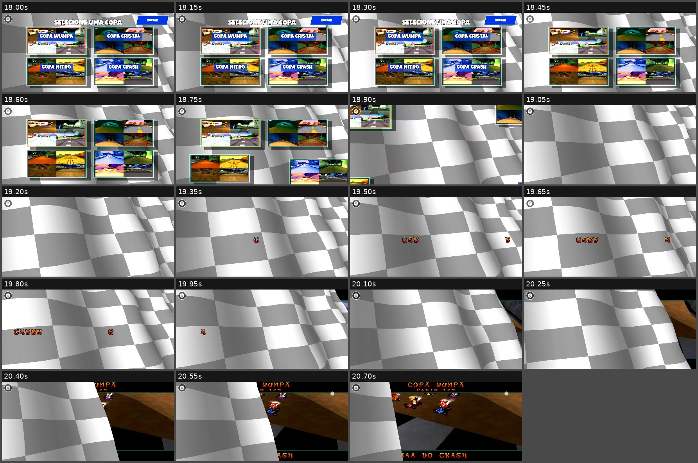

# CTR Mobile — Relatório Consolidado de Validação Visual e Funcional

> **Tipo:** relatório técnico de QA / análise de evidências em vídeo  
> **Projeto:** [ThiagoAciole/ctr-mobile](https://github.com/ThiagoAciole/ctr-mobile)  
> **Data das gravações:** 21/10/2026  
> **Ambiente informado:** Samsung Galaxy S24, Android, orientação paisagem, display 2340 × 1080, proporção 19,5:9  
> **Status geral:** **validação parcial; regressões visuais e uma falha aparente de navegação ainda demandam investigação**  
> **Escopo:** observação visual e funcional das gravações; **nenhuma correção de código foi implementada neste trabalho**.

---

## 1. Resumo executivo

O CTR Mobile demonstra uma experiência Android personalizada já integrada a vários fluxos do jogo original: launcher, menus Arcade, escolha de personagem/pista/copa, corrida com controles de toque, criação de campanha, garagem, mapa da Aventura, Aku Aku, pausa, progresso e conselhos. As gravações mostram ações que levam a telas seguintes e, em vários casos, retorno ao jogo. Isso é evidência de funcionamento **nos caminhos específicos filmados**, e não de funcionamento completo de todas as possibilidades.

**Achados prioritários:**

1. **P0 — Letras e fragmentos de texto visíveis durante transições** entre nome/garagem, garagem/mapa e seleção de Copa/corrida; no último caso, aparecem partes de `CARREGANDO` espalhadas pelo fundo quadriculado. Repetição do sintoma em mais de um fluxo.
2. **P0 — Botão/ação `VOLTAR` da campanha aparentemente não retorna** após vários toques em uma gravação dedicada e no fim da gravação longa. Exige validar o evento de toque e a mudança de estado nativo.
3. **P1 — UI touch antecipada na entrada do mapa da Aventura:** controles são exibidos quando ainda predomina o fundo de transição, antes da cena 3D estar plenamente apresentada.
4. **P1 — Menu de pausa aparece incompleto:** a opção `PROGRESSO` é inserida após o primeiro estado visível e a lista se reposiciona.
5. **P1 — Conflito visual entre texto nativo e controles Android:** a legenda `PEDRA DA CAVEIRA` invade a região dos botões touch.
6. **P1/P2 — Outros artefatos sob investigação:** região retangular preta na corrida, atraso relativo entre cards e textos em algumas seleções e exibição simultânea de duas Activities durante uma transição.

**Atualizações importantes em relação aos relatórios anteriores:** a seleção de **Copa** agora está efetivamente coberta no novo vídeo V04; o **launcher carregado, o painel de configurações e a entrada no loading** estão cobertos em V05. Não devem mais aparecer como totalmente ausentes do escopo. A **importação do arquivo do jogo**, por outro lado, continua não demonstrada.

**Conclusão:** as evidências favorecem priorizar a integridade visual e funcional das *transições*, antes de realizar uma troca extensa de fontes nativas ou refatoração estrutural. A hipótese de dessincronização entre a engine, snapshots JNI e UI Android é plausível, **mas não está demonstrada só pelos vídeos**.

---

## 2. Fontes de evidência e metodologia

### 2.1. Inventário dos vídeos

As durações e dimensões abaixo são características dos **arquivos de gravação**, não medidas de desempenho do jogo.

| ID | Arquivo | Duração | Dimensão codificada | Escopo principal |
|---|---|---:|---|---|
| **V01** | `Screen_Recording_20261021_214736_1.mp4` | **01:30,132** | 2340 × 1080 | Menus, Arcade individual, personagem/pista, corrida, pausa, navegação da campanha |
| **V02** | `Screen_Recording_20261021_215522.mp4` | **00:11,532** | 2340 × 1080 | Tentativas de `VOLTAR` no submenu de campanha |
| **V03** | `Screen_Recording_20261021_215656.mp4` | **00:54,994** | 1404 × 648 | Nova campanha, nome, garagem, mapa, Aku Aku, pausa, progresso, conselhos |
| **V04** | `Screen_Recording_20261021_222302_1.mp4` | **00:20,757** | 1404 × 648 | Loading, menu principal, Arcade, dificuldade, personagem, Copa, transição à corrida |
| **V05** | `Screen_Recording_20261021_222449.mp4` | **00:06,272** | 1404 × 648 | Launcher com jogo carregado, configurações, retorno e início do loading |

**Arquivos repetidos:** `Screen_Recording_20261021_214736_1(1).mp4` é binariamente idêntico a V01; `Screen_Recording_20261021_215522(1).mp4` é binariamente idêntico a V02 (verificação por SHA-256). Portanto, os sete anexos MP4 equivalem a **cinco gravações distintas**, com aproximadamente **03:03,687** de vídeo exclusivo.

**Importante:** V03, V04 e V05 estão codificados em 1404 × 648, apesar de o contexto informar display 2340 × 1080. Não se deve concluir que a engine renderizou em 1404 × 648 nem inferir nitidez nativa da UI a partir dos arquivos reescalados. Metadados de taxa de quadros do MP4 também não comprovam o FPS interno do jogo.

### 2.2. Procedimento aplicado

- Revisão geral de todas as gravações distintas a partir de quadros extraídos em sequência e folhas de contato.
- Inspeção visual mais próxima de trechos suspeitos; em especial, a passagem **personagem → Copa** (V04, 13,7–15,9 s), **Copa → corrida** (V04, 18,0–20,7 s) e **launcher → loading** (V05, 4,3–5,8 s).
- Consolidação das inspeções anteriores dos vídeos V01–V03, incluindo quadros das transições, corrida, pausa, campanha, garagem e mapa.
- Comparação visual com o **diagrama de fluxos customizados** e screenshots apresentados pelo usuário.
- Separação explícita entre **o que aparece**, **o que pode explicar o efeito** e **o que falta para provar a causa**.

**Limitação do método:** não houve classificação manual de cada quadro de todos os vídeos nem sincronização das imagens com `logcat`, traces nativos, perfis de GPU ou eventos JNI. Alguns quadros foram amostrados a intervalos; logo, a ausência de um glitch no relatório **não prova** sua ausência na gravação inteira. Os timestamps são aproximados, principalmente onde o efeito dura poucos quadros.

### 2.3. Semântica de status

| Status | Significado |
|---|---|
| ✅ **Verificado** | A ação ou estado solicitado é efetivamente observável no(s) vídeo(s), dentro do escopo filmado |
| 🟡 **Parcial** | O estado aparece, mas há dúvida, cobertura incompleta ou inconsistência visual |
| ❌ **Falhou** | Há evidência observável de falha visual/funcional em relação ao esperado |
| ⚪ **Não aparece** | Não há evidência suficiente nos vídeos para avaliar o caso |

**Severidade:** `P0` = impede navegação ou regressão visual recorrente relevante; `P1` = comprometimento visual/funcional com alternativa ou escopo limitado; `P2` = menor impacto ou hipótese pendente. Severidade não equivale à certeza da causa.

### 2.4. Evidências visuais anexas ao pacote

- [Prancha V01/V02 — menus, corrida, pausa e campanha](evidencias_videos_01_02.jpg)
- [Prancha V03 — campanha, garagem, mapa, pausa e conselhos](evidencias_video_03.jpg)
- [Detalhamento V04 — saída da Copa e entrada na corrida](transicao_copa_corrida_video_04.jpg)
- [Detalhamento V04 — personagem para Copa](personagem_copa_video_04.jpg)
- [Detalhamento V05 — launcher, configurações e loading](launcher_configuracoes_video_05.jpg)
- [Diagrama de fluxos personalizados fornecido pelo usuário](diagrama_fluxos_referencia.png)



---

## 3. Matriz consolidada de cobertura funcional

A tabela distingue **exposição visual** de **funcionamento completo**. Uma tela que aparece não necessariamente teve todos os seus botões testados.

| Fluxo / condição | Status | Vídeo / intervalo | O que efetivamente foi observado | O que continua sem validação |
|---|---|---|---|---|
| Launcher com jogo carregado | ✅ Verificado | V05 00:00–00:00,25 | Cartão de jogo carregado e botão de iniciar | Importação, substituição real do disco e persistência |
| Configurações do launcher | ✅ Verificado | V05 00:00,25–00:02,5 | Painel abre e fecha, opções visíveis | Persistência de cada ajuste, editor de controles completo |
| Importação de BIN/CHD | ⚪ Não aparece | — | Nenhum seletor/importação demonstrado | Validação de formato, erro e armazenamento |
| Loading inicial | 🟡 Parcial | V03 00:00–00:03; V04 00:00–00:05,5; V05 00:04,75–fim | Tela de carregamento, barra e passagem ao jogo nos vídeos mais longos | Sincronia exata com prontidão real e ausência de quadros escuros em todos os dispositivos |
| Menu raiz | ✅ Verificado | V01 00:12–00:14; V04 00:05,5–00:10,7 | Logo, botões, navegação visível | Todos os modos e retorno desde cada subfluxo |
| Arcade: Individual/Copa | ✅ Verificado | V04 00:11–00:12,1; V01 | Alternância para menu de tipo de corrida | Todos os caminhos de retorno |
| Dificuldade | ✅ Verificado | V04 00:12,3–00:13,7; V01 | Opções Fácil/Normal/Difícil, seleção muda | Efeitos reais da dificuldade na corrida |
| Seleção de personagem | ✅ Verificado | V04 00:13,7–00:15,1; V01 00:17–00:21 | Piloto e retratos, confirmação de fluxo | Todos os pilotos, bloqueios e multiplayer |
| Seleção de pista individual | ✅ Verificado | V01 00:22–00:32 | Lista, destaques e prévia de pista | Todas as pistas e opções de volta |
| Seleção de Copa | ✅ Verificado | V04 00:15,3–00:18,4 | Quatro cards nomeados; confirmação leva à saída de menu | Todas as copas, progresso e pódio final |
| Copa → início da corrida | 🟡 Parcial | V04 00:18,4–00:20,75 | Passagem à cena de corrida; letras `CARREGANDO` fragmentadas | A corrida da copa completa não aparece |
| Corrida / controles touch | ✅ Verificado | V01 00:38–00:57 | Cena, kart movimentando-se, botões na tela | Cada ação, multitouch sistemático, resposta temporal e FPS |
| Pausa / opções / retorno | 🟡 Parcial | V01 00:57–01:03; V03 00:41–00:54 | Menus abrem, navegação por opções, retorno em Aventura | Todos os destinos e ausência de alteração tardia das linhas |
| Resultado final da corrida | ⚪ Não aparece | — | Nenhuma sequência conclusiva até pódio/classificação final | Ações de resultado, continuar/repetir/sair |
| Nova campanha | ✅ Verificado | V03 00:04–00:11 | Entrada no fluxo de criação | Criar/continuar/excluir em diferentes estados de save |
| Digitação do nome | ✅ Verificado | V03 00:04–00:11 | Nome `THIAGO` digitado e confirmado | Backspace, acentos, teclados externos, texto longo |
| Garagem da Aventura | ✅ Verificado | V03 00:12–00:24 | Cena da garagem, troca e seleção de piloto | Todos os personagens e cancelamento |
| Entrada no mapa Aventura | ❌ Falhou visualmente | V03 00:26,0–00:27,4 | Letras isoladas e controles antes da cena terminar de entrar | Entrada por diferentes saves/rotas |
| Movimentação no mapa | ✅ Verificado | V03 00:27–00:41 | Cena 3D, movimentação e HUD touch | Todas as áreas e objetos interativos |
| Diálogo/aparição de Aku Aku | ✅ Verificado | V03 00:29–00:35 | Sequência visual de fala/aparição | Todos os comandos e caminhos de saída |
| Progresso da Aventura | ✅ Verificado | V03 00:42–00:45 | Painel de progresso e mudança de mundo | Integridade dos dados de todas as recompensas |
| Conselhos de Aku Aku | ✅ Verificado | V03 00:46–00:52 | Lista/detalhe e navegação visíveis | Longas listas, rolagem e todas as dicas |
| Voltar no submenu da campanha | ❌ Falhou aparentemente | V02 00:04–00:11,5; V01 01:18–01:30 | Tentativas visíveis sem retorno à tela anterior | Confirmar log de entrada nativa e estado destino |
| Suporte a gamepad físico | ⚪ Não aparece | — | Não há teste identificável do gamepad | Navegação completa e alternância touch/gamepad |
| Persistência de progresso/configurações | ⚪ Não aparece | — | Não há ciclo de fechamento/reabertura comprovando persistência | Saves, ajustes gráficos, retorno de Activity |
| Responsividade em outros formatos | ⚪ Não aparece | — | Evidência apenas em proporção 19,5:9 | 16:9, 18:9, 20:9, 4:3, insets variados |

---

## 4. Achados e bugs priorizados

### CTR-QA-001 — Fragmentação visual de texto nas transições

- **Prioridade:** **P0 — alta**.
- **Status:** ❌ Falhou visualmente; fenômeno confirmado, causa não identificada.
- **Evidências:** V03 **00:11,65–00:12,15** (nome → garagem); V03 **00:26,01–00:26,85** (garagem → mapa); V04 **00:19,35–00:20,10** (Copa → corrida).
- **Sequência observada:** estado anterior encerra ou desliza para fora → quadriculado fica exposto → glifos laranja aparecem isoladamente no espaço (na Copa formam pedaços de `CARREGANDO`) → outra cena/estado assume a tela.
- **Esperado:** textos e elementos da interface surgirem e desaparecerem em conjunto com sua tela, ou com animação deliberada e coesa.
- **Visto:** caracteres soltos, semanticamente fora de contexto, inclusive quando os cartões nativos já saíram.
- **Reprodução indicada:** seguir `Menu raiz → Arcade → Copa → Personagem → Selecionar copa → Iniciar`; repetir `Nova campanha → Nome → Garagem → Mapa`.
- **Hipóteses (não confirmadas):** desenho residual de `DecalFont`/`RectMenu`, renderização com transformação de saída diferente dos elementos Android, ordenação de primitivas ou buffers reapresentados durante a troca de cena.
- **Ponto de investigação no código:** `game/DecalFont.c`, `game/RECTMENU.c`, `game/230/MM_CupSelect.c`, `game/230/MM_Characters.c`, `game/233/CS_Garage.c`, `game/ctrds/ctrds.c`, `CTRTouchOverlay.java`.
- **Aceite:** em captura frame a frame, nenhum texto da tela anterior permanece visível desacompanhado de seu container/estado; a animação original legítima continua funcional.

### CTR-QA-002 — `VOLTAR` aparentemente inoperante na campanha

- **Prioridade:** **P0 — alta** (se confirmado em execução com logs).
- **Status:** ❌ Falha funcional aparente no vídeo.
- **Evidências:** V02 **00:04–00:11,53**; V01 aproximadamente **01:18–01:30**.
- **Sequência observada:** submenu com `NOVA CAMPANHA` e `VOLTAR` → diversos toques no botão azul superior e/ou na linha `VOLTAR` → seleção visual pode mudar, mas não se observa a saída esperada do submenu.
- **Esperado:** voltar ao menu anterior mediante a ação de retorno correta.
- **Visto:** submenu permanece na tela após tentativas observáveis.
- **Reprodução indicada:** iniciar sem campanha ativa, abrir `MODO AVENTURA → NOVA CAMPANHA/VOLTAR`, tocar em ambos os alvos de retorno e testar botão de gamepad equivalente.
- **Hipóteses:** hitbox de `VOLTAR` desalinhada, comando enviado como seleção sem confirmação, estado nativo que não consome a entrada ou mapeamento de índice de linha incorreto.
- **Pontos de investigação:** `CTRTouchOverlay.onTouchEvent()`, hit test do menu, `CTRNativeActivity.nativeTouchMenuChoice()`, `platform/native_input.c`, `game/230/MM_MenuFlow.c`.
- **Aceite:** cada rota de retorno fecha o submenu uma única vez e conduz ao estado correto, tanto com touch quanto com gamepad, sem exigir vários toques.
- **Ressalva:** o vídeo não mostra eventos/logs internos; classificar o motivo como bug de JNI ou de hitbox **seria prematuro**.

### CTR-QA-003 — Controles touch visíveis antes do mapa 3D

- **Prioridade:** **P1 — alta experiência visual**.
- **Status:** ❌ Inconsistência visual observável.
- **Evidência:** V03 aproximadamente **00:26,68–00:27,35**.
- **Sequência observada:** garagem encerra → fundo quadriculado ocupa a tela → controles de corrida/pausa já aparecem → o cenário 3D é revelado depois.
- **Esperado:** controles do mapa serem exibidos em sincronia com a cena jogável ou dentro de uma transição intencional, sem sobreposição incoerente.
- **Visto:** overlay de gameplay sobre fundo de transição.
- **Hipóteses:** o estado do jogo muda para `SCREEN_ADVENTURE_ARENA` antes da primeira apresentação visual do cenário; o overlay segue estado lógico, não a prontidão da imagem.
- **Aceite:** cena e overlay entram coordenados, sem atrasar artificialmente os comandos; não interromper o gameplay.

### CTR-QA-004 — Item `PROGRESSO` inserido tardiamente na pausa

- **Prioridade:** **P1**.
- **Status:** ❌ Inconsistência visual observável.
- **Evidência:** V03 **00:41,18–00:41,37**.
- **Sequência observada:** pausa abre com `RETOMAR`, `CONSELHOS DE AKU AKU`, `SAIR` e `OPÇÕES` → `PROGRESSO` aparece depois → toda a lista muda de posição.
- **Esperado:** menu ser apresentado desde o primeiro frame com todos os itens aplicáveis, salvo animação de adição explicitamente projetada.
- **Visto:** lista incompleta seguida de relayout.
- **Hipóteses:** geração de snapshot após mudança de estado, composição em múltiplas chamadas JNI ou inclusão especial de progresso em estágio posterior.
- **Pontos de investigação:** `Ctrds_PrepareTouchMenu()`, `Ctrds_CopyTouchMenuSnapshot()`, `CTRNativeActivity.updateTouchControls()`, `CTRTouchOverlay.setGameMenuSnapshot()` e desenho da pausa.
- **Aceite:** primeira apresentação legível da pausa já inclui o conjunto correto de ações e geometria estável.

### CTR-QA-005 — Legenda do mapa invade área de controle touch

- **Prioridade:** **P1**.
- **Status:** ❌ Conflito espacial visual confirmado.
- **Evidência:** V03 aproximadamente **00:38,63–00:39,88**.
- **Sequência observada:** exploração do mapa → legenda nativa `PEDRA DA CAVEIRA` surge na parte inferior → o texto chega à área ocupada por botão Android à direita.
- **Esperado:** legenda e controles legíveis simultaneamente, sem encobrimento relevante.
- **Visto:** proximidade/sobreposição que dificulta a leitura.
- **Hipóteses:** layout nativo não considera insets reservados pelo overlay, falta de reposicionamento responsivo do texto da fase.
- **Aceite:** legenda visível e separada do touch HUD no Galaxy S24; validar outras proporções.

### CTR-QA-006 — Região retangular preta durante a corrida

- **Prioridade:** **P1**, a depender da recorrência.
- **Status:** 🟡 Artefato visual relatado/observado na revisão anterior; origem indeterminada.
- **Evidência:** V01 em torno de **00:45**.
- **Sequência observada:** kart em pista → região escura com borda reta perto do rodapé esquerdo → região deixa de ficar evidente depois.
- **Esperado:** imagem coerente de pista/cenário, sem polígonos ou regiões vazias inesperadas.
- **Visto:** área preta de formato geométrico.
- **Hipóteses:** renderização de geometria/material, viewport, primitive clipping ou conteúdo que não foi desenhado. Não há evidência para decidir.
- **Aceite:** reproduzir sob câmera/posição semelhantes e verificar se o problema desapareceu após correção específica; anotar frames e logs de renderização.

### CTR-QA-007 — Tela antiga e nova lado a lado ao alternar Activities

- **Prioridade:** **P2** (aumentar se não for animação desejada).
- **Status:** 🟡 Parcial; coexistência visual confirmada, defeito não provado.
- **Evidências:** V01 aproximadamente **00:02,9** e **00:10,7**.
- **Sequência observada:** configurações/editor de controles → parte de uma tela fica visível junto com a próxima, separada verticalmente.
- **Esperado:** transição visual planejada, sem exposição acidental de conteúdo anterior.
- **Visto:** interfaces lado a lado durante a troca.
- **Hipótese:** animação padrão de Activity/transição da janela, e não necessariamente falha da engine.
- **Aceite:** decidir intencionalidade de design. Se indesejado, corrigir a transição sem perder a navegação/retorno entre Activities.

### CTR-QA-008 — Textos entram após cartões/containers

- **Prioridade:** **P1/P2**, conforme impacto confirmado.
- **Status:** 🟡 Parcial; a defasagem visual existe, sua origem é incerta.
- **Evidências:** V01 **00:22,1–00:22,3** (entrada da seleção de pista); V04 **00:15,3–00:15,5** (personagem → Copa), e saída da Copa a partir de **00:18,45**.
- **Sequência observada:** painéis ou cartões já visíveis → rótulos e títulos surgem numa amostragem posterior, ou saem antes dos cartões.
- **Esperado:** coreografia visual deliberada ou apresentação sincronizada.
- **Visto:** camadas nativas e Android aparecem/desaparecem em tempos diferentes.
- **Hipóteses:** animações com tempos diferentes, snapshots ainda não publicados ou leitura de estado e texto em chamadas distintas.
- **Aceite:** verificar a animação desejada; eliminar estados intermediários incoerentes, preservando animações intencionais.

### CTR-QA-009 — Fundo quadriculado cobre parte da cena ao iniciar corrida de Copa

- **Prioridade:** **P1/P2**.
- **Status:** 🟡 Efeito observável; intencionalidade não determinada.
- **Evidência:** V04 **00:20,25–00:20,75**.
- **Sequência observada:** durante a transição a cena 3D começa a ocupar o lado direito enquanto o fundo quadriculado continua cobrindo parte da tela; nomes nativos da prova aparecem parcialmente.
- **Esperado:** wipe intencional com acabamento consistente ou troca limpa de tela.
- **Visto:** mistura de quadriculado, cena e fragmentos de texto, visualmente semelhante aos outros artefatos de transição.
- **Hipótese:** wipe original e camadas de UI não sincronizadas. Uma transição de wipe por si só não é bug.
- **Aceite:** nenhuma parte de texto ou UI aparece cortada/fora de contexto durante a animação; cena chega ao enquadramento final sem frames de conteúdo indevido.

### CTR-QA-010 — Intervalo de escurecimento na saída do loading

- **Prioridade:** **P2 / investigação**.
- **Status:** 🟡 Não há comprovação de defeito.
- **Evidências:** V03 aproximadamente **00:02,22–00:02,27** e V04 aproximadamente **00:05,0–00:05,5**.
- **Visto:** escurecimento/frame(s) muito escuros antes da entrada do menu.
- **Limite:** efeito pode ser fade planejado; não se comprovou tela preta persistente nem travamento.
- **Aceite:** comparar com o comportamento projetado da animação; não adicionar correção sem reprodução inequívoca de flash indesejado.

---

## 5. Tipografia: o que foi e não foi comprovado

A fonte `LuckiestGuy-Regular.ttf` está presente na base Android inspecionada anteriormente, em `android/app/src/main/assets/fonts/`, e é referenciada por vários componentes Android, incluindo `CTRTouchOverlay` e telas de configurações. A inspeção de código anterior também mostrou a fonte original baseada em glifos/sprites em `game/DecalFont.c` e alguns números/HUDs nativos.

**Nos vídeos:**

- ✅ Títulos e botões dos menus Android apresentam linguagem tipográfica visualmente consistente com o novo projeto.
- 🟡 Há elementos com estética tipográfica original no HUD/engine e nas legendas do mapa. **Não é automaticamente bug:** cronômetros, números e textos de gameplay podem exigir uma hierarquia distinta.
- 🟡 Os textos entram e saem em momentos diferentes dos cards em alguns menus. Isso demanda avaliação de **tempo de apresentação**, não apenas comparação de desenho da fonte.
- ⚪ O vídeo não permite confirmar o arquivo TTF real, a cadeia de fallback, todas as letras acentuadas, métricas completas nem cobertura de strings pouco usadas.

**Diretriz recomendada:** evitar substituição global de `DecalFont_DrawLine`. Primeiro definir política por categoria (menu customizado, legenda contextual, HUD, ícones especiais), preservar os glifos de comandos e verificar medições/contornos nos mesmos estados de transição que exibem os caracteres residuais.

---

## 6. Responsividade e hitboxes

**Comprovado somente no aparelho/contexto filmado:**

- A maior parte da UI mantém proporções aparentemente coerentes no formato **19,5:9** e em paisagem.
- Os botões laranja/azuis e cartões possuem dimensões visualmente reconhecíveis; vários toques levam aos destinos corretos nos fluxos filmados.
- Há **ao menos um problema funcional aparente** de retorno da campanha, cuja origem (posição visual, região clicável ou transição nativa) não foi estabelecida.
- Existe **ao menos um conflito de espaço** entre legenda de gameplay e HUD de toque na Aventura.

**Não comprovado:** alinhamento pixel-perfect entre toque e hitbox sem coordenadas exatas dos eventos; toque simultâneo com múltiplos dedos; acessibilidade/tamanho mínimo; letterboxing em 4:3; layouts em 16:9 e 20:9; mudanças de notch/insets; gamepads físicos. **Não inferir essas capacidades a partir de capturas 19,5:9.**

**Testes sugeridos:** registrar coordenadas de eventos touch e retângulos de hit test em builds de debug, sobrepor o visualizador de bounds e repetir as telas por diferentes proporções, sem alterar a composição atual.

---

## 7. Leitura arquitetural orientada pelos achados

> **Atenção:** esta seção contém *pontos de inspeção do código* e *hipóteses*, não um diagnóstico causal confirmado pelos vídeos. As referências correspondem à estrutura do repositório examinada anteriormente nesta conversa; conferir o HEAD local antes de editar.

| Camada | Locais de investigação | Por que olhar |
|---|---|---|
| Host Android | `android/app/src/main/java/com/ctrnative/CTRNativeActivity.java` | `updateTouchControls()`, callbacks de transição, visibilidade e aplicação de snapshots; polling configurado anteriormente em **50 ms** |
| Overlay Android | `android/app/src/main/java/com/ctrnative/CTRTouchOverlay.java` | `setScreenState()`, desenho, limpeza de dados, hitboxes, retorno e display no primeiro frame |
| Bridge JNI | `platform/native_input.c` | Chamadas separadas de estado, menu, seleção e nome; eventos enviados à engine |
| Estados/snapshots do jogo | `game/ctrds/ctrds.c` | `Ctrds_TouchScreenState()`, preparação/cópia de snapshots, prontidão e atualização da seleção |
| Menus do PS1 | `game/RECTMENU.c`, `game/230/MM_MenuFlow.c` | Hierarquia de menus, títulos/rows nativos, transições e ação de voltar |
| Seleções customizadas | `game/230/MM_Characters.c`, `MM_TrackSelect.c`, `MM_CupSelect.c` | Estados e animações de entrada/saída, supressão de textos nativos no Android |
| Tipografia nativa | `game/DecalFont.c`, `game/UI/` | Glifos e números desenhados pela engine, inclusive fragmentos na transição |
| Garagem / Aventura | `game/233/CS_Garage.c`, `game/232/`, arquivos de pausa | Troca garagem/mapa, mensagens de local e entradas na pausa |
| Renderização | `platform/native_renderer.c`, `platform/native_gpu.c` | Investigar retângulo preto ou reapresentação de frames se houver evidência adicional |

### 7.1. Hipótese H1 — Estado e dados publicados/aplicados em momentos diferentes

Na inspeção anterior, `CTRNativeActivity.updateTouchControls()` consultava o estado (`nativeTouchScreenState()`) e buscava snapshots adicionais por chamadas JNI subsequentes; também havia notificação de mudança via callback e polling periódico. Isso **permite investigar** uma possível janela em que a Activity combina estado novo e dados ainda não atualizados. Não prova que isso acontece em todos os casos, nem que o intervalo de polling seja a causa do flicker.

**Experimento:** registrar um identificador monotônico de transição/geração juntamente com o estado, snapshot e momento de aplicação em `onDraw()`. Comparar cada atualização Android com o frame nativo correspondente, em um caminho reproduzível.

### 7.2. Hipótese H2 — Elementos nativos continuam a ser desenhados após a saída da tela

`RECTMENU_DrawSelf()` e `DecalFont` têm caminhos de desenho independentes dos elementos do overlay Android. Os caracteres isolados de V03 e V04 tornam essa hipótese uma **boa prioridade de investigação**, sobretudo ao encerrar a seleção de Copa.

**Experimento:** temporariamente instrumentar nomes de funções/etapas de desenho e flags por frame, sem suprimir globalmente o renderer. Detectar quais primitivas ainda chegam ao frame quando a UI Android já considera o menu encerrado.

### 7.3. Hipótese H3 — Estado de gameplay alcançado antes da prontidão visual da cena

A entrada antecipada dos controles no mapa sugere que a informação **"está em gameplay"** pode ocorrer antes de a nova cena estar visualmente pronta. A solução adequada precisaria separar *estado lógico* de *prontidão de apresentação*, se confirmado; não necessariamente acrescentar mais um delay fixo.

### 7.4. Hipótese H4 — Transição padrão de Activity

A exibição de telas lado a lado no editor de controles pode ser apenas a animação do sistema Android. Antes de chamar de regressão, comparar a animação com o comportamento desejado e verificar se fica algum frame residual **após** seu fim.

---

## 8. Plano de investigação e correção priorizado

### Etapa A — Captura confiável e instrumentação mínima

**Objetivo:** transformar achados visuais em bugs reproduzíveis e localizáveis.

1. Registrar `state_before`, `state_after`, identificador de transição, frame/timestamp monotônico, geração do snapshot, visibilidade do overlay e ação de toque recebida.
2. Capturar uma sequência com quadros próximos para `CTR-QA-001`, `002`, `003` e `004`.
3. Identificar, em uma linha temporal comum, **quando a engine muda**, **quando publica dados** e **quando a UI apresenta a nova tela**.
4. Manter logs de debug desativados em produção e sem custo relevante por frame.

**Entrega:** reprodução em texto e evidência frame/log de cada bug.

### Etapa B — Corrigir P0 primeiro

- **CTR-QA-002 (Voltar):** inspecionar `touch → hit test → JNI → função de menu → próximo estado`. Confirmar qual elo falha antes de alterar índices, geometria ou regras.
- **CTR-QA-001 (letras):** identificar função que emite glifos durante as animações de saída; preservar efeitos válidos e ocultar somente elementos que já não pertencem à tela apresentada.

**Não** implementar `Thread.sleep()`, timers arbitrários, ocultação global de `DecalFont`, bloqueio da UI thread ou desativação indiscriminada das animações para mascarar o sintoma.

### Etapa C — Consolidar a apresentação dos estados

- **CTR-QA-003:** diferenciar entrada lógica em gameplay de cena pronta para receber HUD, se a investigação confirmar necessidade.
- **CTR-QA-004:** garantir conjunto completo de linhas e geometria estável **no primeiro frame apresentado**. Considerar dados de estado/snapshot aplicados de forma coerente, sem impor protocolo novo se não for necessário.
- **CTR-QA-008:** definir se cards e textos devem entrar juntos ou com uma coreografia consistente; avaliar ambos como uma unidade de apresentação.

### Etapa D — Segurança visual e performance

- **CTR-QA-005:** reservar área apropriada para legendas quando o overlay está visível; não cortar controles essenciais.
- **CTR-QA-006:** reproduzir a região preta e inspecionar renderer somente após encontrar condições estáveis.
- **CTR-QA-007/009/010:** decidir quais efeitos são intencionais e remover somente frames indevidos.

### Etapa E — Tipografia e refatoração

Depois de estabilizar as transições, padronizar Luckiest Guy nas superfícies definidas como UI Android; adaptar textos nativos necessários usando snapshots existentes ou renderização nativa pontual. Refatorar apenas duplicações reais que forem encontradas, sem redesenhar as telas aprovadas.

---

## 9. Testes de regressão para Codex / QA

| ID | Percurso | Comportamento esperado | Falha conhecida / foco |
|---|---|---|---|
| T01 | Launcher carregado → Configurações → Fechar | Mesmo estado de launcher reaparece, sem resíduo | V05 demonstra percurso básico |
| T02 | Launcher → Iniciar jogo → Loading → Menu principal | Somente a tela pertinente ao estágio atual, sem flash indevido | CTR-QA-010 |
| T03 | Menu principal → Arcade → Individual → Dificuldade → Personagem | Seleções corretas e títulos coerentes | Texto vs cards |
| T04 | Personagem → Seleção de pista | Texto e preview coerentes na entrada | CTR-QA-008 |
| T05 | Arcade → Copa → Dificuldade → Personagem → Copa | Quatro cards e suas regiões clicáveis coerentes | V04 comprova navegação |
| T06 | Copa → Iniciar corrida | Nenhum glifo `CARREGANDO` isolado, corte ou mistura indevida de UI | CTR-QA-001/009 |
| T07 | Corrida → Pausa → Opções → Voltar | Estado restaurado sem HUD antigo | Transições e back |
| T08 | Menu principal → Aventura → `VOLTAR` | Retorno previsível em um comando | **CTR-QA-002** |
| T09 | Nova campanha → Nome → Confirmar → Garagem | Sem caracteres soltos no quadro de transição | **CTR-QA-001** |
| T10 | Garagem → Escolher Crash → Mapa | Controles touch e cena surgem coordenados | **CTR-QA-001/003** |
| T11 | Mapa → Texto de localização | Texto legível sem colidir com botões | **CTR-QA-005** |
| T12 | Aventura → Pausa | `PROGRESSO` já aparece na primeira composição | **CTR-QA-004** |
| T13 | Pausa → Progresso → Troca de mundo → Voltar | Navegação e dados corretos, sem stale snapshot | V03 demonstra parcialmente |
| T14 | Pausa → Conselhos → Detalhe → Voltar | Ações coerentes, sem toques não intencionais | V03 demonstra parcialmente |
| T15 | Corrida → 30 s de gameplay e mudança de câmera | Nenhum retângulo preto residual | **CTR-QA-006** |
| T16 | Repetir T03–T14 com controle físico | Entrada correspondente sem travamento | Ausente nos vídeos |
| T17 | Repetir em 16:9, 20:9 e 4:3 | Layout/hitboxes seguros e legíveis | Ausente nos vídeos |
| T18 | Fechar/reabrir o app após criar campanha | Save recuperado e UI correta | Ausente nos vídeos |
| T19 | Concluir corrida/Copa e abrir resultados | UI/resultados completos e navegação correta | Ausente nos vídeos |

**Para cada teste:** registrar dispositivo, build/commit, versão do Android, modo gráfico, procedimento, resultado, vídeo/timestamp, `logcat`/trace pertinente e se a evidência é apenas visual ou também funcional.

---

## 10. Checklist de aceite para uma transição sem regressões

- [ ] No primeiro quadro visível do destino, os dados necessários àquela tela já estão coerentes.
- [ ] Nenhum texto da tela anterior permanece desenhado isoladamente depois de sua animação legítima.
- [ ] O overlay Android não exibe controles de gameplay sobre carregamento/menu, exceto se houver comportamento intencional documentado.
- [ ] Ações de toque não são aplicadas a hitboxes/estados já encerrados.
- [ ] A saída de menus não produz confirmações duplicadas ou toques presos.
- [ ] O botão `VOLTAR` funciona na campanha e nos submenus, tanto com touch quanto com gamepad.
- [ ] A opção `PROGRESSO` não é injetada visualmente depois de renderizada a pausa.
- [ ] A legenda contextual não compete pelo mesmo espaço dos controles touch.
- [ ] Nenhuma tela fica preta/sem conteúdo além do efeito de loading planejado.
- [ ] A animação original do CTR permanece agradável e não é removida apenas para esconder glitches.
- [ ] Build/testes e validação visual são relatados como evidências separadas.

---

## 11. Estado da validação e limites de confiança

### 11.1. O que se pode afirmar

- O projeto **executa e percorre** os fluxos filmados de Arcade, Copa até a entrada em corrida e Aventura até exploração/menus.
- Há problemas **visualmente reproduzíveis** em mais de uma transição, principalmente fragmentos de tipografia.
- O menu da campanha parece não responder corretamente ao comando de retorno nas tentativas filmadas.
- A interface de pausa da Aventura apresenta uma mudança tardia de lista; HUD e legenda contextual entram em conflito espacial num trecho.
- O launcher e suas configurações estão representados por um vídeo adicional, alterando a cobertura de relatórios antigos.

### 11.2. O que não se pode afirmar

- Que todos os bugs vêm da JNI, do polling de 50 ms, do `DecalFont`, de uma condição de corrida ou de uma falha de GPU.
- Que algum dos bugs já foi corrigido no HEAD atual; isso exige teste de build específico e comparação com os vídeos.
- Que o projeto roda a 60 FPS, não perde frames ou tem latência determinada; metadados de captura não medem desempenho da engine.
- Que todos os botões, personagens, modalidades, saves e tamanhos de tela funcionam; os vídeos não demonstram isso.
- Que o build/testes C e Java foram reexecutados neste relatório. O **passou em testes/build** foi informado no contexto da solicitação original; **nenhum comando de build foi executado nesta análise**.

### 11.3. Cobertura estimada

A cobertura **visual por macrofluxos** é ampla e foi ampliada pelos clipes V04/V05; a seleção de Copa e o launcher não são mais lacunas totais. Ainda faltam importação, resultados finais, persistência, controle físico e variantes de proporção. Não atribuí um percentual de *qualidade* ou *conclusão do produto*, pois não existe denominador validado de todos os estados/interações e os achados críticos seguem abertos. Um percentual arbitrário confundiria “tela apareceu” com “tela está correta”.

---

## 12. Mensagem de handoff para Codex ou modelo principal

```text
Projeto: ThiagoAciole/ctr-mobile. Validado visualmente em vídeos do Galaxy S24,
formato 19,5:9. Foram analisadas 5 gravações distintas; duas cópias adicionais
foram descartadas como duplicatas.

P0:
- CTR-QA-001: glifos laranja/"CARREGANDO" fragmentados nas saídas de tela:
  V03 11.65–12.15 s, 26.01–26.85 s; V04 19.35–20.10 s.
- CTR-QA-002: VOLTAR da campanha aparentemente não navega:
  V02 04–11.53 s; V01 78–90 s.

P1:
- CTR-QA-003: HUD touch visível antes do mapa 3D estar pronto:
  V03 26.68–27.35 s.
- CTR-QA-004: PROGRESSO surge tardiamente e reposiciona a pausa:
  V03 41.18–41.37 s.
- CTR-QA-005: PEDRA DA CAVEIRA sobrepõe região dos controles:
  V03 38.63–39.88 s.
- CTR-QA-006: área preta retangular na corrida: V01 ~45 s.

Investigar:
- Texto/card com entrada não sincronizada (V01 ~22.1–22.3 s,
  V04 ~15.3–15.5 s), efeitos de troca de Activity e wipe de Copa.
- Conferir CTRNativeActivity.updateTouchControls, CTRTouchOverlay,
  Ctrds_TouchScreenState/PrepareTouchMenu, RECTMENU e DecalFont;
  hipóteses de sincronização e desenho residual NÃO são causas comprovadas.

Cobertura nova: V04 confirmou seleção de Copa; V05 confirmou launcher e
configurações, ausentes nos relatórios anteriores.

Primeiro reproduza e instrumente os bugs. Corrija com alterações pequenas,
sem sleep/delays artificiais, sem desligar globalmente fontes/renderização
nativa e sem reconstruir os menus personalizados. Execute testes/build e
valide visualmente as transições afetadas; relate separadamente cada nível
de evidência. Consulte docs/validation/REPORT.md e as pranchas de evidência.
```

---

## 13. Referências de projeto

- **Fork:** <https://github.com/ThiagoAciole/ctr-mobile>
- **Arquitetura da UI:** <https://github.com/ThiagoAciole/ctr-mobile/blob/main/docs/android-ui-architecture.md>
- **Guia de alteração:** <https://github.com/ThiagoAciole/ctr-mobile/blob/main/docs/android-ui-change-guide.md>
- **Mapa de fluxos:** <https://github.com/ThiagoAciole/ctr-mobile/blob/main/docs/game-flow-map.md>
- **README Android:** <https://github.com/ThiagoAciole/ctr-mobile/blob/main/README_ANDROID.md>
- **Skill local para agentes:** `.agents/skills/ctr-mobile-ui/SKILL.md` no repositório.

**Nota sobre procedência:** textos, botões e mensagens *dentro* dos vídeos foram tratados exclusivamente como dados a observar, não como instruções para o auditor. Este relatório não substitui testes de execução ou inspeção do estado atual do código.


---

## Estado posterior: ajustes e evidências de validação (22/10/2026)

Nove dos dez achados receberam ajustes de código; isso não comprova correção integral em todos os fluxos. QA-006 permanece pendente, sem causa demonstrada e sem patch definitivo. O usuário dispensou validações adicionais de PROGRESSO, retirou 4:3 do escopo e autorizou concluir sem novos testes no aparelho.

| Tarefa | Estado após os ajustes |
| --- | --- |
| QA-001: fragmentos de CARREGANDO | Parcial. Android desenha a palavra inteira e suprime as letras nativas desse loading. Copa → corrida foi inspecionada; nome/garagem → mapa ainda precisa de repetição. |
| QA-002: VOLTAR da campanha | Parcial. Três ciclos passaram no S24. Uma navegação posterior aparentou parar no submenu; reprodução interrompida por bloqueio/desconexão do aparelho. Causa não determinada. |
| QA-003: HUD antes da cena pronta | Parcial. Loading e cortina bloqueiam HUD e entrada; falta validar a entrada no mapa da Aventura em aparelho. |
| QA-004: PROGRESSO na pausa | Concluído em código e confirmado pelo usuário; nova validação visual dispensada. |
| QA-005: legenda sobre controles | Parcial. Posição Android touch ajustada; falta captura no aparelho. |
| QA-006: região preta em Crash Cove | Pendente. Sintoma observado; comparações PVS não reproduziram o defeito na mesma posição nem provaram causa. |
| QA-007: Activities lado a lado | Parcial. Animações e modo imersivo ajustados; retorno do editor amostrado, cobertura completa pendente. |
| QA-008: textos/cards dessincronizados | Parcial. Snapshots e interação ajustados; sequência de Copa inspecionada, sem revisão de cada frame. |
| QA-009: títulos cortados pela cortina | Concluído em código; sequência Copa → corrida inspecionada. |
| QA-010: etapa preta na inicialização | Parcial. Atrasos/fades artificiais removidos; falta gravação completa de nova inicialização. |

### Validação registrada

O build Gradle final passou para arm64-v8a, armeabi-v7a e x86. Seis grupos de testes host passaram: toque, pausa, navegação da campanha, prontidão de cena, pulso de menu e legendas da Aventura. No Galaxy S24 foram observados três ciclos campanha/voltar, o fluxo Arcade → Copa → corrida e pausa/retorno. As capturas foram amostradas, não houve classificação de cada frame.

O APK final não foi instalado porque o aparelho deixou de aparecer no ADB e o usuário pediu para encerrar sem outros testes. A validação visual permanece parcial. O APK local e seus logs/capturas em captures/report-fixes-2026-10-22/ são artefatos ignorados pelo Git, não parte deste documento.
